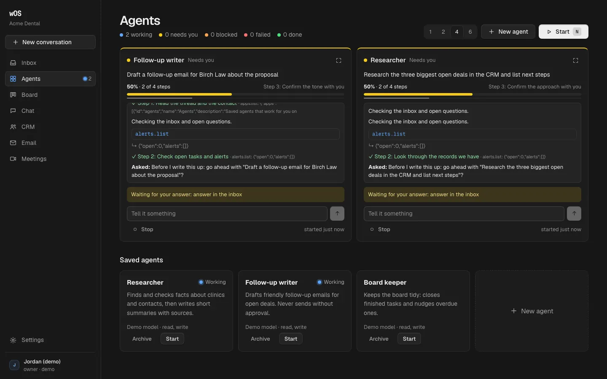
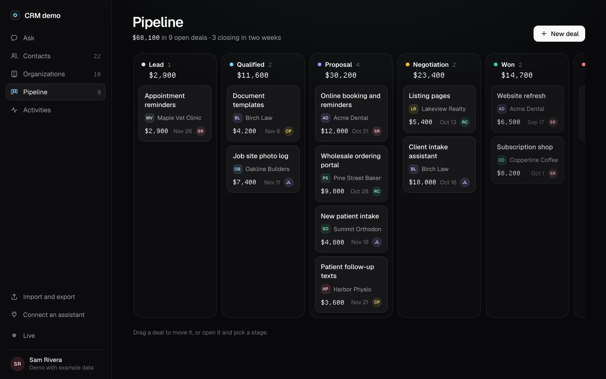

# Anthony Venturini

**AI Builder · Full-Stack Engineer · Metro Detroit**

I build complete AI products end to end — idea, code, design, launch — and I build them fast.
10+ years full-stack (TypeScript, Node, React, Next.js, GraphQL, Postgres, AWS), 5 years as Engineering Lead, and an agent-first workflow with Claude Code and Cursor.

---

## Shipped

### [warOnSaaS](https://waronsaas.com) · [GitHub org](https://github.com/warOnSaaS) · [live demo](https://app.waronsaas.com)

An open-source, agent-native suite that replaces rented business software: one app where a team and its AI agents work side by side.

  
  

- **wOS** opens on a conversation, with Agents, Board, CRM, Chat and Email around it. Replaces Salesforce, Slack, Gmail, Zoom, Trello/Asana.
- **Every button is a tool.** Anything a person does on screen, an agent can do. The same tools are served over **MCP** to Claude, ChatGPT, Codex and Claude Code.
- **Bring your own model:** Anthropic or OpenAI key, local models via Ollama, or any OpenAI-compatible server.
- **agent-kanban:** a shared board for people and their agents, stored as markdown in the team's own GitHub repo, with hand-offs, agent reviews, and a board rendered inside Claude/ChatGPT chats (MCP Apps).
- **Self-host in one command** (`docker compose up`: app, Postgres, HTTPS) or solo on SQLite. AGPL, no licence checks.

Repos: [suite](https://github.com/warOnSaaS/suite) · [agent-kanban](https://github.com/warOnSaaS/agent-kanban) · [scanner](https://github.com/warOnSaaS/scanner) · [chat](https://github.com/warOnSaaS/chat) · [email](https://github.com/warOnSaaS/email) · [meet](https://github.com/warOnSaaS/meet) · [site](https://github.com/warOnSaaS/site)

`TypeScript` `Node 22` `MCP` `Postgres / SQLite` `Docker + Caddy` `Multi-model`

### [Big Kid Moments](https://bigkidmoments.com)

Personalized, illustrated and narrated stories that help kids get ready for big moments: a new sibling, the first day of school, a big birthday.

- **The home page is the product.** No landing page; anyone can explore a sample family and its stories without signing up.
- **Generation built into the app:** parents add their family and the moment; the story is written, illustrated and narrated for that child.
- Tested with real kids. They love it.

`Consumer AI` `Story generation` `Image + voice pipeline` `Web, native next`

### [Agentic Intent](https://agenticintent.co)

An agentic web partner for marketing agencies: making client websites readable and actionable for AI assistants and agents.

- **AI-readiness scoring:** grades how well a site can be read and used by AI assistants, then lifts it.
- **Benchmarked the S&P 500** to show how much of the web is still invisible to AI assistants.
- **White-label for agencies:** a phased engagement agencies resell to their own clients.

`Agentic web` `AI SEO` `B2B / agencies`

---

## Experience

- **AI Engineer, Automate Dojo**: AI automation and web development.
- **AI Engineer, EpoxyGrind**: programmatic-SEO and lead-gen platform for contractors.
- **Engineering Lead, RiverGuide** (5 years): led a SaaS platform for Amazon publishing agencies, including per-customer integrations.

## How I work

- Ship complete products, not prototypes.
- Agent-first development: Claude Code, Cursor, MCP.
- Stack: TypeScript · Node · React · Next.js · GraphQL · PostgreSQL · AWS.
- Comfortable owning product, design and go-to-market.

---

Metro Detroit, MI · [github.com/adventurini](https://github.com/adventurini)
